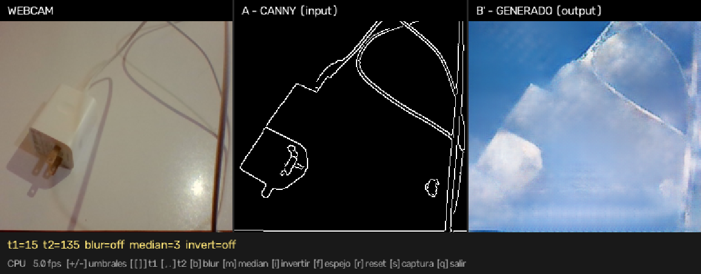
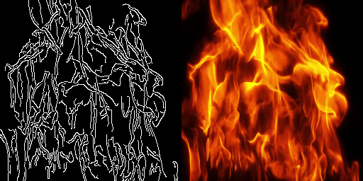

# Learning to See

Réplica técnica de la pieza **[Learning to See](https://www.memo.tv/works/learning-to-see/)** de Memo Akten, construida con **PyTorch** y **pix2pix**. Una red generativa que solo conoce un tipo de imagen (fuego, mar, nubes, flores) intenta reinterpretar *cualquier* cosa que le muestres a través de la cámara como si fuera de ese mundo.



*De izquierda a derecha: lo que ve la webcam, los bordes (Canny) que recibe el modelo y la imagen que "alucina". Aquí, un cargador de móvil interpretado por el modelo de nubes.*

---

## Cómo funciona

El truco conceptual es entrenar pix2pix con **un solo dominio** de imágenes. El par de entrenamiento no son dos imágenes distintas, sino la misma imagen y su versión de bordes:

```
A (entrada)  = cv2.Canny(imagen)     <- lo que el modelo "ve"
B (objetivo) = la imagen original    <- lo que el modelo "imagina"
```

Como el generador solo ha visto fuego (o mar, o flores), cuando en inferencia recibe los bordes de un trapo o de un papel arrugado no puede hacer otra cosa que rellenar esa forma con la materia que conoce.

```
webcam -> resize 256x256 -> [median -> blur] -> Canny -> A
                                                        |
                                         generador U-Net 256
                                                        v
                                                alucinación B'
```

| Par de entrenamiento (A &#124; B) |
|---|
|  |

## Modelos entrenados

| Modelo | Tecla | Imágenes | Canny (t1/t2) | Épocas | L1 validación |
|---|:---:|---:|:---:|---:|---:|
| Fuego | `1` | 682 | 50 / 150 | 100 | **17,3** / 255 |
| Mar | `2` | 522 (filtradas) | 20 / 60, blur 5, median 3 | 130 | 36,3 / 255 |
| Nubes | `3` | — | — | — | — |
| Flores rojas | `4` | 197 | 40 / 120 | 200 | 26,2 / 255 |

Los umbrales de Canny en vivo no son los del entrenamiento: una escena de webcam produce menos bordes que las fotos del dataset, así que cada modelo lleva un *preset* calibrado a mano (ver [docs/INFERENCE.md](docs/INFERENCE.md)).

## Características

- **Pipeline de datos reproducible**: validación del dataset crudo y generación de pares A|B con Canny configurable (`check_dataset.py`, `preprocess_canny.py`).
- **Entrenamiento con pix2pix** (cGAN + L1, generador `unet_256`, discriminador PatchGAN) sobre el repositorio de referencia de Jun-Yan Zhu, incluido como submódulo.
- **Inferencia en vivo desde webcam** con cambio de modelo en caliente (teclas `1`-`4`), ajuste de umbrales en tiempo real, captura de pantalla y modo a pantalla completa.
- **Aceleración multiplataforma**: CUDA, Apple Silicon (MPS) o CPU, seleccionado automáticamente.
- **La aceleración no degrada la imagen**: en cada arranque se compara la salida del acelerador con una referencia en CPU y se descarta si difiere más de la tolerancia. `--half` (fp16) solo se activa si es correcto *y* más rápido.
- **Rendimiento**: ~62 fps en una GTX 1050 (4 GB) frente a ~4 fps en CPU.

## Estructura del repositorio

```
learning_to_see/
├── pix2pix/                 # submódulo: junyanz/pytorch-CycleGAN-and-pix2pix
├── preprocess_canny.py      # imágenes crudas -> pares A|B
├── check_dataset.py         # valida el dataset antes de preprocesar
├── webcam_inference.py      # demo en vivo con webcam
├── setup_mac.sh             # instalación en macOS (Apple Silicon)
├── run_mac.sh               # lanzador para macOS
├── requirements.txt
├── logs/                    # registros de los entrenamientos
└── docs/                    # guías detalladas e imágenes
```

Los datasets de imágenes (`entrenamiento/`, `data/`) y los pesos entrenados (`checkpoints/`, ~200 MB por generador) **no se versionan**; ver [Datos y modelos](#datos-y-modelos).

## Instalación

```bash
git clone --recurse-submodules <URL-DEL-REPOSITORIO>
cd learning_to_see
```

Si ya clonaste sin submódulos: `git submodule update --init`.

**Windows / Linux**

```powershell
python -m venv .venv
.\.venv\Scripts\Activate.ps1          # Linux/macOS: source .venv/bin/activate

# GPU NVIDIA (CUDA 12.6)
pip install torch torchvision --index-url https://download.pytorch.org/whl/cu126
pip install -r requirements.txt
```

**macOS (Apple Silicon)**

```bash
bash setup_mac.sh
```

La build estándar de PyTorch para macOS ya incluye MPS; no hace falta ningún índice especial.

## Uso

### 1. Preparar el dataset

```bash
python check_dataset.py --input_dir ./data/raw_images
python preprocess_canny.py --preview 8 --t1 60 --t2 180 --pre_blur 3 --pre_median 3   # calibrar
python preprocess_canny.py --t1 60 --t2 180 --pre_blur 3 --pre_median 3 --val_frac 0.05
```

Genera `data/AB/train/*.png`, cada uno de 512x256 = `[A | B]`.

### 2. Entrenar

Desde `pix2pix/`:

```bash
python train.py --dataroot ../data/AB --name mi_modelo \
  --model pix2pix --direction AtoB --dataset_mode aligned \
  --load_size 256 --crop_size 256 --batch_size 1 \
  --n_epochs 65 --n_epochs_decay 65 --save_epoch_freq 10 \
  --checkpoints_dir ../checkpoints
```

Detalles y recomendaciones en [docs/TRAINING.md](docs/TRAINING.md).

### 3. Inferencia en vivo

```bash
python webcam_inference.py                    # Windows / Linux
bash run_mac.sh                               # macOS
python webcam_inference.py --benchmark 50     # fps sin necesitar webcam
```

| Tecla | Acción |
|---|---|
| `1` `2` `3` `4` | cambiar de modelo (con su preset de filtrado) |
| `+` `-` | subir / bajar ambos umbrales de Canny |
| `b` / `m` | ciclar blur gaussiano / mediana previos |
| `i` · `f` · `r` | invertir bordes · espejo · restaurar preset |
| `s` | guardar captura |
| `h` · `q` | alternar ayuda · salir |

La lista completa de opciones, el diagnóstico de cámara y las medidas de rendimiento están en [docs/INFERENCE.md](docs/INFERENCE.md).

## Datos y modelos

- **Datasets**: imágenes propias por dominio (fuego, mar, flores). No se incluyen por tamaño (~550 MB, más de 9 500 imágenes). Para reproducir un modelo, coloca tus imágenes en `data/raw_images/` y sigue el paso 1.
- **Pesos**: `checkpoints/<modelo>/latest_net_G.pth`. El script de inferencia los busca en `checkpoints/fire`, `sea`, `v2` (nubes) y `flores_rojas`.

## Decisiones de diseño

- **Un dominio, no dos.** Es lo que da sentido a la pieza: el modelo no traduce entre estilos, "rellena" bordes con lo único que conoce.
- **Estiramiento a 256x256 sin preservar proporción**, igual que el pipeline original, para que preproceso e inferencia coincidan exactamente.
- **Normalización idéntica al entrenamiento** (`(x - 0.5) / 0.5`), y generador construido con la misma fábrica de `pix2pix/models/networks.py`.
- **Captura de cámara deliberadamente simple.** Los intentos de acelerarla con hilos o forzando backends empeoraron la imagen en Windows; el razonamiento está documentado en [docs/INFERENCE.md](docs/INFERENCE.md).

## Créditos

- **Memo Akten**, autor de [Learning to See](https://www.memo.tv/works/learning-to-see/) y de [webcam-pix2pix-tensorflow](https://github.com/memoakten/webcam-pix2pix-tensorflow), de donde se toma el patrón de preprocesado.
- **Jun-Yan Zhu et al.**, [pytorch-CycleGAN-and-pix2pix](https://github.com/junyanz/pytorch-CycleGAN-and-pix2pix).
- Isola et al., [*Image-to-Image Translation with Conditional Adversarial Networks*](https://arxiv.org/abs/1611.07004), CVPR 2017.

## Licencia

Este proyecto se distribuye bajo la licencia [MIT](LICENSE). El submódulo `pix2pix/` conserva su propia licencia (BSD) y los datasets de imágenes pertenecen a sus respectivos autores.
